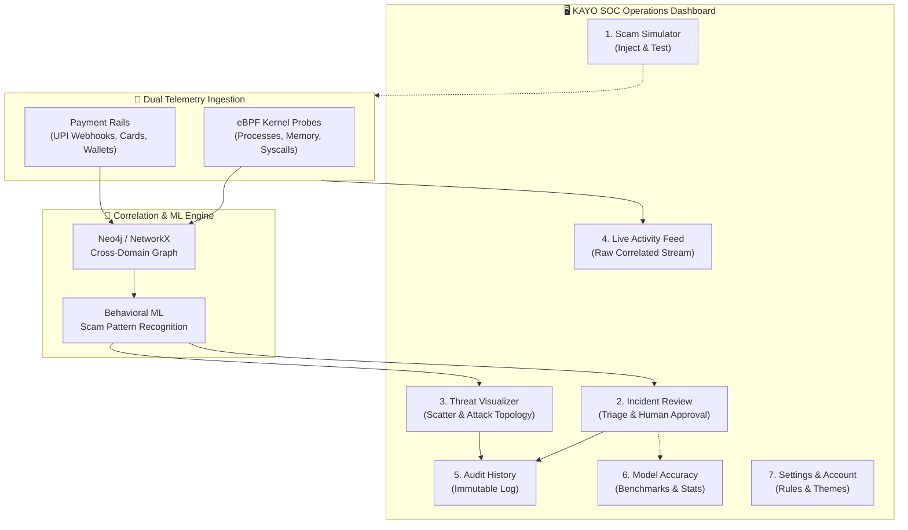

# KAYO SOC Dashboard — Complete Visualizer & Tabs Reference Guide

> **Document Type:** Reading & Operational Reference  
> **System:** KAYO — AI-Driven Scam Pattern Recognition & Cross-Domain Threat Correlation  
> **Platform Version:** CodeSlayer 2k26 Edition • DevSphereIndia  
> **Target Audience:** Security Analysts (SOC Tier 1–3), Fraud Investigators, System Evaluators, and Hackathon Judges  

---

## 📑 Table of Contents
1. [Executive Summary & Architecture Flow](#1-executive-summary--architecture-flow)
2. [Quick Reference Matrix](#2-quick-reference-matrix)
3. [Tab 1: Scam Simulator (Live Demo & Testing)](#tab-1-scam-simulator-live-demo--testing)
4. [Tab 2: Incident Review (Active Threat Triage & Guided Action Center)](#tab-2-incident-review-active-threat-triage--guided-action-center)
5. [Tab 3: Threat Visualizer (Dual Radar & Cyber-Financial Graph)](#tab-3-threat-visualizer-dual-radar--cyber-financial-graph)
6. [Tab 4: Live Activity Feed (Synchronized Dual Telemetry Stream)](#tab-4-live-activity-feed-synchronized-dual-telemetry-stream)
7. [Tab 5: Audit History (SOC Governance & Containment Ledger)](#tab-5-audit-history-soc-governance--containment-ledger)
8. [Tab 6: Settings & Account (Themes, AI Models & Defense Policies)](#tab-6-settings--account-themes-ai-models--defense-policies)
9. [End-to-End Operational Lifecycle of a Scam](#10-end-to-end-operational-lifecycle-of-a-scam)

---

## 1. Executive Summary & Architecture Flow

The KAYO Dashboard connects **cybersecurity telemetry** (Linux eBPF kernel probes, process injections, memory dumps) with **financial transaction activity** (NPCI UPI rails, NetBanking, digital wallets). 

Rather than viewing these as separate silos, the dashboard correlates them into a unified threat picture.



---

## 2. Quick Reference Matrix

| Navigation Tab | Route ID | Primary Information Displayed | How It Works & Visualizes |
| :--- | :--- | :--- | :--- |
| **Scam Simulator** | `simulator` | Real-world attack scenarios, money saved counters, and payload injector. | 4-step chronological attack storyboard cards + 1-click live backend attack trigger + dual view modes (Human Story vs Kernel Console). |
| **Incident Review** | `incidents` | Active threat alerts, confidence %, loss at risk, explainable AI causes, and predicted attack paths. | Scrollable queue list with severity badges (`CRITICAL`, `HIGH`, `MEDIUM`) + detailed forensic target matrix + 1-click human-in-the-loop action approval modal. |
| **Threat Visualizer** | `graph` | Live transaction scoring scatter plot, spatial impossible travel velocity, and cross-domain entity graph. | **50/50 side-by-side view**: Left column shows risk scatter (0–100%) and Mach-speed travel calculations; right column renders interactive SVG entity graph with node telemetry inspector. |
| **Live Activity Feed** | `telemetry` | Raw dual-stream telemetry: low-level OS kernel syscalls and real-time UPI payment webhooks. | Two synchronized streaming terminal columns with live pulse indicator, Pause/Resume toggle, and "Filter Anomalies Only" checkbox. |
| **Audit History** | `audit` | Cryptographically verifiable record of all analyst containment actions and automated policies. | Chronological audit ledger cards displaying Action ID, Incident ID, Operator Name, Decision (`APPROVED`/`REJECTED`), Timestamp, and Forensic Notes. |
| **Settings & Account** | `settings` | Theme appearance, **AI Model Accuracy Benchmarks**, Operator credentials, and defense policies. | 4-tab integrated view: **Appearance & Themes**, **AI Model & Accuracy Benchmarks** (107k dataset, PaySim/UNSW-NB15 ML metrics, USPs, report viewer), **Defense Rules**, and **Operator Profile**. |

---

## Tab 1: Scam Simulator (Live Demo & Testing)

### 🎯 Purpose
The **Scam Simulator** is an interactive testing laboratory designed to demonstrate how KAYO neutralizes sophisticated, multi-stage cyber-financial attacks before any funds are lost.

### 📊 What Information It Shows
1. **Three Curated High-Impact Scenarios**:
   * **Scenario A — Fake Utility Bill APK (Screen-Sharing PIN Theft / Infostealer)**:
     * *Story*: Fraudsters send an SMS/WhatsApp claiming an electricity bill is overdue. Victim installs a malicious APK that silently records the screen during UPI PIN entry.
     * *Prevented Loss*: `₹1,48,500 ($1,941)`.
   * **Scenario B — Coordinated Money Mule Syndicate (Rapid Laundering Chain)**:
     * *Story*: Compromised banking credentials used to bounce funds across 4 different mule accounts in under 90 seconds to evade static bank velocity rules.
     * *Prevented Loss*: `₹75,000 ($980)`.
   * **Scenario C — Fake Bank Customer Care (Remote Phone Takeover & OTP Hijack)**:
     * *Story*: Social engineering impersonation call tricking victim into granting accessibility permissions, followed by automated ghost-touch approval of OTPs.
     * *Prevented Loss*: `₹2,24,000 ($2,928)`.
2. **Prevented Capital & Zero-Loss Counter**: Clear metrics showing 100% of victim funds protected.
3. **Four-Step Storyline Breakdown**: Visual step-by-step path detailing Infiltration ➔ Privilege Escalation ➔ Exfiltration Attempt ➔ Automated Interception.

### ⚙️ How It Works & How It Visualizes It
* **"Run Live Simulation" Button**: Dispatches an HTTP `POST` to `/api/simulator/attack`, injecting actual simulated events into the backend graph and pushing alerts to the incident queue.
* **Dual Event Feed Toggle**:
  * **Plain-English / Human Story**: Displays executive-friendly cards detailing the sequence of protections (*"App Monitor detected screen recording"*, *"AI Engine flagged Tor IP"*, *"Payment frozen before leaving victim account"*).
  * **Kernel Console**: Switches to high-density terminal logs showing eBPF memory offsets, system call hooks, and sub-millisecond NPCI rail handshake latency.

---

## Tab 2: Incident Review (Active Threat Triage & Guided Action Center)

### 🎯 Purpose
The central operations desk for SOC analysts to review active security incidents, inspect explainable AI reasoning, and authorize containment actions.

### 📊 What Information It Shows
1. **Active Incident Queue**:
   * Incident ID (e.g., `INC-2026-9041`, `INC-2026-4412`).
   * Threat Level (`CRITICAL`, `HIGH`, `MEDIUM`) with confidence percentage (e.g., `96.8%`).
   * Incident Title & Loss Amount at Risk (e.g., `₹1,48,500`).
   * Current Lifecycle Status (`NEW` vs `CONTAINED`).
2. **Target Entity Matrix**:
   * Victim Customer Account name.
   * Banking Account / Destination UPI VPA handle.
   * Flagged Origin IP Address.
   * Suspicious Process / Binary Name (e.g., `svchost.exe (Injected: RedLine)`).
3. **Explainable AI Root Causes ("What the AI Detected")**:
   * Plain-English bullet points explaining the multi-source causal correlation (e.g., *Tor exit node IP matched*, *unauthorized memory read targeting UPI token*, *impossible velocity spike*).
4. **Predictive Progression Path ("What the Scammer Would Do Next")**:
   * Proactive AI forecast showing the expected next step of the attacker (e.g., *“Scammer would fan out ₹1,48,500 to 4 second-tier mule accounts within 45 seconds to bypass withdrawal freezes”*).
5. **Recommended Actions (Human-in-the-Loop)**:
   * Action items with impact assessments (e.g., `FREEZE_UPI_MULE`, `ISOLATE_PROCESS`, `BLOCK_C2_IP`, `REVOKE_SESSION`).

### ⚙️ How It Works & How It Visualizes It
* **Master-Detail Layout**: A 1/3 left sidebar displays the scrollable alert queue, and the 2/3 right panel displays full forensic detail for the selected incident.
* **Action Approval Modal**: Clicking any recommended action opens an authorization dialog requiring the analyst's name and verification notes. This ensures strict **Human-in-the-Loop** compliance and prevents unintended automated customer disruptions.
* **Direct Incident Selection**: Selecting an incident updates the selected threat across the dashboard and updates the graph snapshot.

---

## Tab 3: Threat Visualizer (Dual Radar & Cyber-Financial Graph)

### 🎯 Purpose
A real-time, high-contrast visualizer designed to present both **transaction risk scoring scatter** and **cross-domain entity graph topology** side by side.

### 📊 What Information It Shows
The visualizer is permanently organized into a **50/50 dual side-by-side layout**:

#### 1. Left Column: Real-Time Scoring Scatter & Spatial Velocity Inspector
* **Scattering Risk Plot (0% ➔ 100% Risk)**:
  * Real-time streaming transaction points plotted on risk score against time.
  * Three color-coded decision thresholds:
    * 🔴 **Block Tier (>75% Risk)**: Highlighted with floating amount badges (e.g., `$1,941`, `$7,226`).
    * 🟡 **Review Tier (40%–75% Risk)**: High-velocity micro-transfers requiring analyst inspection.
    * 🟢 **Approved Tier (<40% Risk)**: Normal baseline customer spending.
* **Spatial Velocity & Impossible Travel Inspector**:
  * **Cardholder Origin vs. Merchant POS Geolocation**: Physical distance calculation (e.g., `Chicago, IL ➔ Los Angeles, CA = 1,745 miles`).
  * **Minimum Flight Time vs. Actual Delta Time**: Evaluates whether physical displacement is possible (e.g., Minimum flight: `4h 12m`, Actual elapsed: `2.14 mins`).
  * **Implied Velocity & Mach Speed Anomaly**: Shows impossible speed (e.g., `48,925 mph / Mach 64`), proving stolen credentials or cloned digital sessions.
  * **Quick Vector Switcher**: 1-click scenario buttons (*Chicago ➔ LA*, *Mumbai ➔ Amsterdam*, *Bengaluru ➔ Singapore*, *New Delhi ➔ Frankfurt*).

#### 2. Right Column: Unified Entity Relationship Topology & Forensic Inspector
* **Attack Propagation Graph**:
  * An interactive SVG canvas mapping the flow of an attack:
    `[Victim User]` ➔ `[Device]` ➔ `[Injected Process]` ➔ `[C2 Server IP]` ➔ `[Bank Account]` ➔ `[Mule UPI VPA]` ➔ `[Transaction]`.
  * Animated pulsing rings indicating active compromise.
  * Category filter buttons (`ALL`, `Process`, `IP`, `UPI_Account`, `Transaction`).
* **Forensic Entity Inspector**:
  * Displays telemetry details for whichever node is clicked: Process ID, injection status, IP address, socket connections, and risk score.
  * Direct **"Contain Entity"** toggle to quarantine the node immediately.
* **Bottom AI Correlator Strip**: Summary explanation linking the low-level kernel injection with the outbound financial transfer.

### ⚙️ How It Works & How It Visualizes It
* **Responsive Height Optimization**: The entire dual visualizer fits cleanly within standard display heights (826px) without vertical page scrolling.
* **Currency Switcher**: Top header toggle to view values in **USD ($)** or **INR (₹)**.
* **Live Streaming Animation**: SVG canvas dynamically updates with streaming points, animated particle edges, and real-time EPS (events per second) throughput counters.

---

## Tab 4: Live Activity Feed (Synchronized Dual Telemetry Stream)

### 🎯 Purpose
High-throughput observability window streaming raw events from the operating system kernel and payment rails side by side.

### 📊 What Information It Shows
1. **Left Terminal: eBPF Kernel Probes**:
   * System calls monitored: `sys_enter_execve`, `sys_enter_ptrace`, `sys_enter_mprotect`, `sys_enter_connect`.
   * Process metadata: PID, binary name (e.g., `svchost.exe`, `whatsapp_updater.apk`), memory access flags, and privilege escalation flags.
   * Severity tags: `CRITICAL`, `WARNING`, `INFO`.
2. **Right Terminal: Payment Banking Webhooks**:
   * Financial events: UPI Pay Request, Card Present, Wallet Top-up, IMPS Transfer.
   * Payload details: Sender VPA, Receiver VPA, Amount, Bank IFSC, Velocity counter (transfers in last 5 min), and device fingerprint match boolean.

### ⚙️ How It Works & How It Visualizes It
* **Live Polling Loop**: Polls `/api/telemetry/live` every 2.8 seconds to stream real-time data into a circular buffer of the 100 most recent events.
* **Filter Anomalies Only**: A toggle checkbox to suppress benign transactions and highlight only memory scans, privilege escalations, and unverified devices.
* **Live / Pause Button**: Allows analysts to pause the scrolling stream at any moment to copy or inspect a specific event payload.

---

## Tab 5: Audit History (SOC Governance & Containment Ledger)

### 🎯 Purpose
Provides a verifiable, regulatory-compliant audit ledger of every defensive action executed within KAYO.

### 📊 What Information It Shows
* **Unique Action ID**: Auto-generated sequential audit hash (e.g., `ACT-001`).
* **Correlated Incident ID**: Links the action directly to the flagged incident (e.g., `INC-2026-9041`).
* **Action Executed**: Specific remediation type (e.g., `FREEZE_UPI_MULE`, `ISOLATE_PROCESS`, `BLOCK_C2_IP`).
* **Operator Attribution**: Name of the authorizing security analyst (e.g., `Lead Analyst Vikram Sen`).
* **Decision Status**: `APPROVED` (Green badge) or `REJECTED` (Red badge).
* **Timestamp**: Exact execution time down to the second.
* **Analyst Justification Notes**: Mandatory commentary entered during approval (e.g., *"Confirmed DLL injection signature. Immediate freeze authorized to protect victim balance"*).

### ⚙️ How It Works & How It Visualizes It
* Fetches audit records from `/api/audit-logs`.
* Complies with **Role-Based Access Control (RBAC)** standards, ensuring that automated machine learning decisions are always validated and documented by human authority.

---

## Tab 6: Settings & Account (Themes, AI Models & Defense Policies)

### 🎯 Purpose
Enables SOC operators to configure visual themes (including Pitch Black OLED), inspect serialized ML models and incident benchmarks, adjust defense policies, and manage operational credentials.

### 📊 What Information It Shows
1. **AI Model & Accuracy Benchmarks Sub-Tab**:
   * **Empirical Dataset Distribution**: Breakdown of **1,07,800 historical fraud incidents** analyzed across major threat categories (Card Fraud, UPI Payment Fraud, Online Banking, Account Takeovers).
   * **Machine Learning Benchmarks**: `99.4%` precision on cross-domain correlation, `1.4s` average detection latency, ROC-AUC `0.9996` (PaySim Random Forest) and `0.9888` (UNSW-NB15 Gradient Boosting), with top feature weights.
   * **Four Core Architectural USP Pillars**: Cross-Domain Intelligence, Relationship-Based Detection, Predictive Threat Analysis, and Context-Aware Response.
   * **Team Attribution & References**: DevSphereIndia team members and academic research links.
   * **In-App Project Report Viewer**: Interactive modal to view and copy the full `PROJECT_REPORT.md`.
2. **Appearance & Themes Sub-Tab**:
   * Live theme selector (**Pitch Black (OLED)** default, Sovereign Gold, Royal Sapphire, Sovereign Emerald, Platinum Frost).
   * Display Density toggles (**Executive** vs. **Compact**).
3. **Defense Rules & Engine Sub-Tab**:
   * Auto-Quarantine Risk % slider (e.g., `85%`).
   * UPI Instant Hold limit (e.g., `₹50,000`).
   * Audio/Visual alert siren toggles.
4. **Operator Profile & Credentials Sub-Tab**:
   * Analyst Name (e.g., `Lead Analyst Vikram Sen`).
   * Operational Badge ID (e.g., `SOC-OP-8492`).
   * Clearance Level: `Level 4 - Sovereign Authority`.
   * Department: `Cyber-Financial Crime Division (NPCI/RBI)`.
2. **Theme Customization (5 Sovereign Themes)**:
   * 🖤 **Pitch Black (OLED)** (Default): Deep void pure black (`#000000`) with high-contrast razor-sharp white accents. Maximum contrast, zero eye fatigue, and optimal for OLED/tactical operations.
   * 🌟 **Sovereign Gold**: Institutional banking gold with warm ember accents.
   * 🌊 **Royal Sapphire**: Deep oceanic navy with cyan neon highlights.
   * 🌲 **Sovereign Emerald**: High-contrast jade and emerald cybersecurity aesthetic.
   * ❄️ **Platinum Frost**: Modern high-clarity arctic silver layout.
3. **Display Density**:
   * **Executive View**: Generous spacing, readable cards, and maximum visual clarity.
   * **Compact View**: High-density information layout for multi-monitor SOC command centers.
4. **Automated Defense Rules & Thresholds**:
   * **Auto-Quarantine Risk Slider**: Configurable threshold (e.g., `85%`) above which suspicious processes are isolated automatically.
   * **Auto-Hold UPI Limit**: Configurable transaction amount (e.g., `₹50,000`) requiring secondary device biometric verification.
   * **Sound Alerts**: Audio chime toggle for critical incoming threats.

### ⚙️ How It Works & How It Visualizes It
* Live updates CSS custom properties and HTML data attributes (`data-theme` and `data-density`) without page reloads.
* Automatically syncs all preferences to the browser's `localStorage` for state persistence across sessions.

---

## 10. End-to-End Operational Lifecycle of a Scam

Here is how all 7 tabs interact during an attack:

```
[ Step 1: Inoculation ]
Scam Simulator ───> Dispatches simulated attack (e.g., Fake Utility Bill APK).
                         │
                         ▼
[ Step 2: Ingestion & Detection ]
Live Activity Feed ───> Displays concurrent eBPF memory dump & ₹1,48,500 UPI transfer.
                         │
                         ▼
[ Step 3: Correlation & Triage ]
Incident Review ────> Queues INC-2026-9041 (Critical 96.8%), explains WHY it was flagged,
                      and predicts scammer will fan out funds in 45s.
                         │
                         ▼
[ Step 4: Visual Radar Inspection ]
Threat Visualizer ───> Scatter plot highlights high-risk transaction in Block tier (>75%);
                      Velocity inspector calculates 48,925 mph impossible displacement;
                      Graph maps link between APK process, Tor IP, and destination UPI mule.
                         │
                         ▼
[ Step 5: Guided Containment ]
Incident Review ────> Operator clicks "Freeze UPI VPA" in guided actions modal.
                      Operator enters authorization note and confirms approval.
                         │
                         ▼
[ Step 6: Immutable Compliance ]
Audit History ──────> Creates ACT-001 audit record with timestamp, operator ID, and notes.
                         │
                         ▼
[ Step 7: Benchmarking & Proof ]
Model Accuracy ─────> Reflects 100% prevented capital loss and 1.4s detection latency.
```

---

*Authored for the CodeSlayer 2k26 Hackathon • Team Tasteless Balls • Project KAYO*
