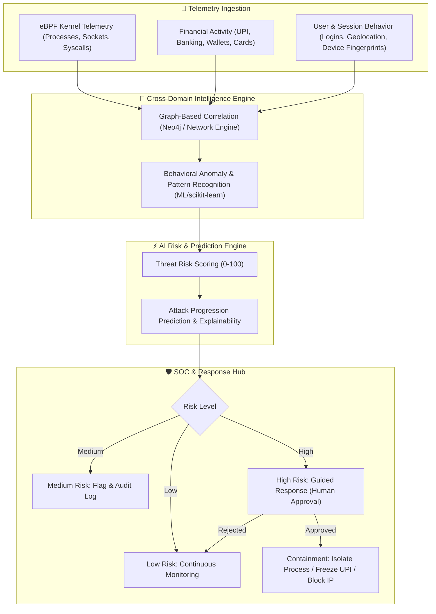

# CODESLAYER 2k26 — Project Report
## **KAYO: AI-Driven Scam Pattern Recognition & Cross-Domain Threat Correlation**

---

## 📌 Project Overview & Team Details

| Item | Details |
| :--- | :--- |
| **Event** | CodeSlayer 2k26 – DevSphereIndia |
| **Project Name** | **KAYO** (AI-Driven Scam Pattern Recognition) |
| **Team Name** | **Tasteless Balls** |
| **Track** | Open Innovation |
| **Team Members** | • **Sada Aizaz** (Frontend) • **Sahil Srivastava** (Backend & ML) • **Vivek Yadav** (API Authentication & Database) |

---

## 1. Executive Summary

**KAYO** is a unified, AI-driven cyber-financial intelligence platform that detects both sophisticated cyberattacks and financial scams by connecting disparate events into a complete threat workflow. It correlates real-time system and network activity (collected through **eBPF**) with financial activity such as **UPI, online banking, and digital wallet transactions** and user behavior.

Rather than analyzing cyber and financial signals in isolation, KAYO builds a **cross-domain threat graph** linking:
- **Users & Identities**
- **Devices & Fingerprints**
- **Accounts & Wallets**
- **Transactions & UPI Payments**
- **Processes & System Executions**
- **IPs & Geolocations**
- **Applications & APIs**

A real-time **AI Risk & Prediction Engine** scores incidents, predicts attack progression paths, and provides context-aware guided responses with mandatory **human-in-the-loop approval** for high-impact containment actions (e.g., account freezing, process isolation, IP blocking).

---

## 2. Problem Statement

### 2.1 The Issue
Modern cyber threats and financial scams are dynamic, multi-stage, and cross-boundary. Traditional defense systems suffer from critical limitations:
- **Siloed Analysis:** Security Operations (SOC) monitor logs and network packets in isolation from Fraud Risk teams who monitor banking ledger logs. They miss multi-stage scams (e.g., malware infostealer stealing session token → unauthorized UPI payment).
- **Alert Fatigue & Noise:** Isolated threshold rules trigger massive false positives, overwhelming analysts.
- **Delayed Incident Response:** By the time an unauthorized transaction is flagged, the attack has already progressed to fund exfiltration.

### 2.2 Financial Cyber Fraud — Incident Distribution
Based on recent cyber-financial threat patterns, reported incidents across major fraud categories are distributed as follows:

| Fraud Category | Reported Incidents | Risk Severity |
| :--- | :--- | :--- |
| **Card / Internet Fraud** | 28,400 | High |
| **UPI / Payment Fraud** | 23,750 | Critical |
| **Online Banking Fraud** | 19,600 | High |
| **Digital Wallet Fraud** | 15,300 | Medium-High |
| **Account Takeover (ATO)** | 11,850 | Critical |
| **Credential / Identity Fraud** | 8,900 | Medium |

### 2.3 Impacted Audience
- **Banking & Financial Institutions:** Protection against account takeover, mule networks, and wire fraud.
- **UPI, Wallet & FinTech Platforms:** Real-time prevention of social engineering, SIM-swap scams, and payment hijacking.
- **SOC & Cyber Defense Teams:** Unified threat visibility across endpoint, network, and financial domains.
- **Enterprises & Cloud Services:** Prevention of credential stuffing, session hijacking, and unauthorized API transactions.

---

## 3. Target Users & Market Segment

| Segment | Sector | Key Stakeholders | Model |
| :--- | :--- | :--- | :--- |
| **Banking & Finance** | Financial Services | Fraud Risk Teams, AML Analysts, SOC Level 2/3 | B2B SaaS |
| **Payment Platforms** | FinTech / Digital Payments | Fraud Analysts, Trust & Safety, Security Engineers | B2B API |
| **Enterprises** | IT / Cloud Infrastructure | SOC Analysts, DevSecOps, Incident Responders | B2B SaaS |
| **Cybercrime Units** | Public Safety & Law Enforcement | Cybercrime Investigators, Forensics Officers | B2G |

---

## 4. Proposed Solution & Architecture

### 4.1 Key Capabilities
1. **Real-Time eBPF & FinTech Telemetry:** Deep Linux kernel observability (syscalls, network flows, injected binaries) coupled with real-time transaction event streams.
2. **Dynamic Cross-Domain Threat Graph:** Heterogeneous graph connecting `(:User)-[:OPERATES]->(:Device)-[:EXECUTES]->(:Process)-[:CONNECTS_TO]->(:IP)-[:INITIATES]->(:Transaction)-[:TARGETS]->(:Account)`.
3. **Predictive Progression Engine:** Predicts the scam's next move (e.g., "Mule account fan-out within 4 minutes") before funds leave the ecosystem.
4. **Human-in-the-Loop Guided Remediation:** One-click containment with full provenance and audit logs.

### 4.2 Tech Stack

| Layer | Technologies |
| :--- | :--- |
| **Frontend** | React, TypeScript, Tailwind CSS / Vanilla CSS, Lucide Icons, Canvas/SVG Graph Visualizer |
| **Backend** | Python, FastAPI, Pandas, scikit-learn, Redis, Kafka stream simulator |
| **Database & Graph** | PostgreSQL, Neo4j / Graph Database Engine |
| **Telemetry** | eBPF (Extended Berkeley Packet Filter) simulation & real-time event parsers |
| **Cloud / Infra** | Microsoft Azure / Containerized Microservices |

---

## 5. Unique Selling Proposition (USP)

| # | Pillar | Description | Business & Security Outcome |
| :-: | :--- | :--- | :--- |
| **1** | **Cross-Domain Intelligence** | Merges eBPF system telemetry with financial transaction streams. | 0-day scam detection across cyber-financial boundary. |
| **2** | **Relationship-Based Graph Detection** | Maps complex mule account rings, shared device IDs, and anomalous IP hops. | Uncovers hidden multi-hop fraud syndicates. |
| **3** | **Predictive Threat Forecasting** | Anticipates attack stages prior to fund exfiltration. | Shifts posture from reactive forensics to proactive prevention. |
| **4** | **Explainable AI & Guided Response** | Provides clear "Why Suspicious" causal graphs and verified actions. | Drastically cuts Mean Time to Respond (MTTR) by ~70%. |

---

## 6. Business Model

- **B2B Tiered SaaS:** Monthly/annual subscription scaled by monitored endpoints and transaction throughput.
- **Per-API Transaction Scoring:** Pay-per-call risk evaluation API for FinTechs and payment gateways.
- **Enterprise Private Cloud / On-Prem:** Dedicated air-gapped or Sovereign Azure deployments for major banking networks.
- **Future B2C Consumer Guardian:** SDK integration in consumer banking apps providing instant scam warnings before OTP submission.

---

## 7. Research References & Documentation
- **Financial Fraud Detection Using Graph Neural Networks (Systematic Review):** [ACM Digital Library](https://dl.acm.org/doi/10.1016/j.eswa.2023.122156)
- **Graph Neural Networks for Financial Fraud Detection (Springer):** [Springer Link](https://link.springer.com/article/10.1007/s11704-024-40474-y)
- **Linux eBPF Documentation & Architecture:** [eBPF.io](https://docs.ebpf.io/)
- **FastAPI Framework Documentation:** [tiangolo.com](https://fastapi.tiangolo.com/)
- **Neo4j Graph Database Documentation:** [neo4j.com](https://neo4j.com/docs/)
- **Kaggle Financial Fraud & Credit Card Datasets:** [Kaggle Fraud Detection](https://www.kaggle.com/datasets/sriharshaeedala/financial-fraud-detection-dataset)
